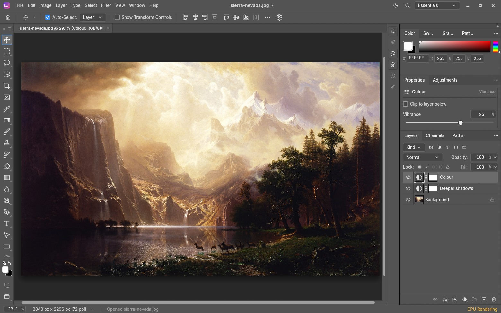
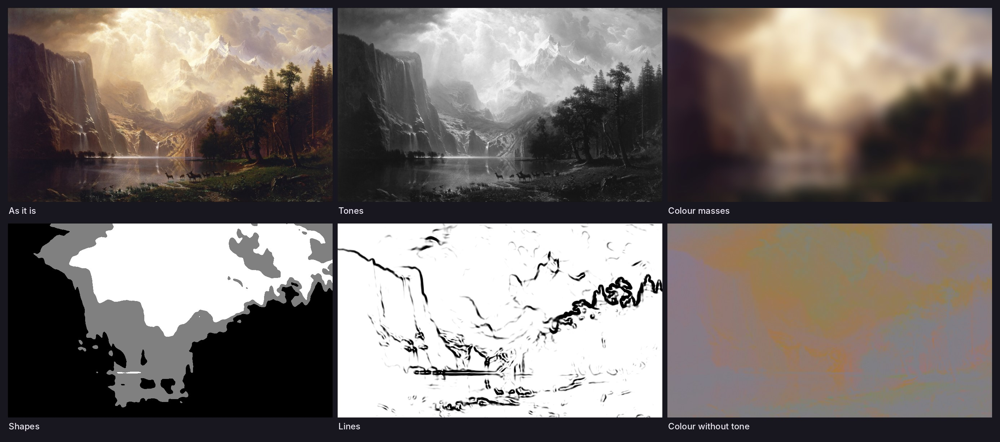

<p align="center">
  
</p>

<h1 align="center">MagicPic</h1>

<p align="center">
  A native, layered image editor written in Rust, built so that you <em>and</em> an AI agent<br>
  can look at a picture, edit it, look again and export it.
</p>

<p align="center">
  
  
  
</p>

<p align="center"><a href="README.vi.md">Tiếng Việt</a></p>

<p align="center">
  
</p>

> **Status: early alpha.** MagicPic is a fork of [PhotoCraft](https://github.com/storytold/photocraft)
> by the ArtCraft team. It is built and tested from source on Linux; nothing here has been
> run on Windows or macOS yet, and there are no installers or releases. See
> [What is verified](#what-is-verified).

## What MagicPic is

- **A real editor.** Layers, groups, masks, adjustment layers, smart objects with smart
  filters, type, vector shapes, a brush engine, filters, selections, history with snapshots.
  RGB, Grayscale, CMYK and Lab documents at 8, 16 and 32 bits per channel, with ICC colour
  management. PSD/PSB, layered TIFF, PNG, JPEG, WebP, OpenEXR and more; its own layered
  format is `.pcraft`.
- **Everything is a command.** Every menu item, tool and dialog runs one of over 1,000
  commands from a single registry. The app, the command line and the agent interface all call
  the same commands, so anything you can click, an agent can do, and nothing is done twice in
  two different ways.
- **Native.** egui on wgpu, no webview and no JavaScript. The same Rust also compiles to
  WebAssembly.

<h4>🧰 69 tools</h4>
Move · Artboard · Rectangular and Elliptical Marquee · Single Row Marquee · Single Column Marquee · Lasso · Polygonal Lasso · Magnetic Lasso · Object Selection · Quick Selection · Magic Wand · Crop · Perspective Crop · Slice · Slice Select · Frame · Eyedropper · Color Sampler · Ruler · Note · Count · Remove · Spot Healing Brush · Healing Brush · Patch · Content-Aware Move · Red Eye · Brush · Pencil · Mixer Brush · Color Replacement · Clone Stamp · Pattern Stamp · History Brush · Art History Brush · Eraser · Background Eraser · Magic Eraser · Gradient · Paint Bucket · Blur · Sharpen · Smudge · Dodge · Burn · Sponge · Pen · Freeform Pen · Curvature Pen · Add Anchor Point · Delete Anchor Point · Convert Point · Horizontal and Vertical Type · Horizontal and Vertical Type Mask · Path Selection · Direct Selection · Rectangle · Ellipse · Triangle · Polygon · Star · Line · Custom Shape · Hand · Rotate View · Zoom

<sub>A test keeps this list equal to the tools the app offers.</sub>

## What MagicPic adds

### Seeing: look before you edit

<p align="center">
  
</p>

Five observation views show one visual property of a picture at a time: its **tones**, its
**colour masses**, its **shapes** against empty space, its **lines**, and its **colour
without tone**. A view is only something to look through. It is never written into the
document, so it cannot end up in an export.

- **View › Seeing** opens a view beside your picture as a separate study.
- **Chance frames** pick places to look at from a seed, not from habit, and the same seed
  finds them again.
- **Variants** try an idea on a copy: more or less exposure, camera movement, defocus, a
  different frame. Your picture is never touched. Each variant stores its **recipe**, and
  replaying the recipe gives the same pixels.
- Nothing scores your picture or picks a winner. You can record your own reaction on a
  variant, in your own words.

How these came from a text about learning to see, and what was deliberately left out, is in
[`docs/seeing.md`](docs/seeing.md).

### An editor an agent can use safely

`magicpic-cli mcp` is an [MCP](https://modelcontextprotocol.io) server. Connect Claude or
Codex to it and say what you want in plain language.

- The agent **sees** the document: the whole picture, one region at full size, or any of the
  observation views.
- It edits with the editor's own commands, preferring adjustment layers, masks and smart
  filters, so the result stays editable.
- **All or nothing:** a batch of edits either applies completely or leaves every open
  document exactly as it was.
- **No overwriting your work:** an edit can be tied to the document and the state the agent
  last saw. If you changed something by hand in the meantime, the agent's edit is refused.
- **Bridge mode** edits the document that is open in the app, so you watch it happen and can
  step in.
- It reads and writes only inside the folders you grant, and a save is reported only after
  the file is found on disk.

```sh
# Headless: the agent opens, edits and exports files in one folder
magicpic-cli mcp --automation-read-root /path/to/photos --automation-write-root /path/to/photos

# Bridge: the agent edits what is open in the running app
magicpic --control 7878 --control-token-file /path/to/control.token \
  --automation-read-root /path/to/photos --automation-write-root /path/to/photos
magicpic-cli mcp --bridge 127.0.0.1:7878 --control-token-file /path/to/control.token
```

Setup for Claude Code, Claude Desktop and Codex, and example prompts, are in
[`docs/vi/art-of-seeing-va-mcp.md`](docs/vi/art-of-seeing-va-mcp.md) (Vietnamese) and
[`docs/mcp.md`](docs/mcp.md).

## Get started

### With an agent

On a new machine, paste this into Claude Code or Codex. The agent installs what is missing
(asking first), installs MagicPic (a prebuilt release when one is published, else a source
build), opens it and connects it to itself; pasting it again later updates.

```text
Install and open MagicPic on this machine, then connect it to yourself over MCP so I can edit
photos by talking to you.

Source: https://github.com/vansyson1308/vansysoneditphoto
Follow the agent instructions exactly:
https://raw.githubusercontent.com/vansyson1308/vansysoneditphoto/main/docs/agent-setup.md
If you cannot read that page, run `git clone --depth 1` on the source above and read
docs/agent-setup.md in the clone.

Ask me before installing system software or using administrator rights. Grant only one photo
folder. Never print the token. At the end, tell me what you did and what to say after I
restart you.
```

The steps it follows are in [`docs/agent-setup.md`](docs/agent-setup.md).

### By hand

You need Rust (stable) and, on Linux, the windowing and GTK development packages listed in
[`docs/development.md`](docs/development.md#prerequisites).

```sh
git clone https://github.com/vansyson1308/vansysoneditphoto magicpic
cd magicpic
cargo run --release -p magicpic -- picture.jpg     # the desktop app
cargo install --path apps/magicpic-cli --locked    # the command line and MCP server
```

```sh
# Headless editing without an agent
magicpic-cli run in.jpg \
  --cmd layer.newAdjustmentLayer.curves --params '{"points":[[0,0],[64,48],[192,212],[255,255]]}' \
  --out out.png

# Every subcommand explains itself
magicpic-cli --help
```

## Documentation

| Read | For |
|---|---|
| [`docs/vi/cai-dat-va-ket-noi.md`](docs/vi/cai-dat-va-ket-noi.md) | Installing in Vietnamese: local install or a cloud session, a prompt that has Claude Code or Codex install it, updating |
| [`docs/vi/art-of-seeing-va-mcp.md`](docs/vi/art-of-seeing-va-mcp.md) | User guide in Vietnamese: Seeing, connecting Claude and Codex, example prompts, what was verified |
| [`docs/seeing.md`](docs/seeing.md) | The observation views, frames, variants, recipes and transactions |
| [`docs/mcp.md`](docs/mcp.md) | The MCP tools, folders and permissions, guarded and atomic edits |
| [`docs/control-protocol.md`](docs/control-protocol.md) | The control channel behind bridge mode |
| [`docs/architecture.md`](docs/architecture.md), [`docs/development.md`](docs/development.md) | How the code is laid out, building, testing |
| [`AGENTS.md`](AGENTS.md) | Rules for contributors and AI agents working on this code |
| [`docs/target-app-parity.md`](docs/target-app-parity.md), [`docs/gaps.md`](docs/gaps.md) | Where the editor stands against Photoshop, and what is missing |

## What is verified

Checked on Linux (x86-64, software rendering), from source:

- The engine, command-line, MCP and UI test suites.
- An end-to-end run through the MCP server: import, tone edit, preview, export and reopening
  the export; a local edit through a mask; variants with replayed recipes; undo and redo;
  saving and reopening a project; failing batches, bad files and forbidden writes.
- Bridge mode against the running desktop app.
- A real editing session with Claude Code, headless and through the bridge.

Not verified:

- **Windows and macOS.** The code is cross-platform and inherited the upstream packaging
  scripts under `packaging/`, but MagicPic has not been built, run or packaged there.
- **Installers, signing and automatic updates.** There are no MagicPic releases. The
  packaging scripts and the CI workflows are inherited and still assume the upstream
  project's infrastructure; they need their own pass before a first release.
- **Codex and Claude Desktop sessions.** The server follows the MCP standard and Codex
  accepts its configuration, but a full session with those clients has not been run.
- **Translations.** The interface is English unless built with the upstream translation
  catalogues (`CRAFT_I18N_DIR`, see [`docs/localization.md`](docs/localization.md)); the build
  then puts MagicPic's name into them. The texts MagicPic added, such as the Seeing menu, are
  English in every language.

## Where MagicPic comes from

MagicPic is a modified version of [PhotoCraft](https://github.com/storytold/photocraft),
Copyright (c) 2026 ArtCraft Team and the PhotoCraft contributors, used under the MIT and
Apache-2.0 licenses. The editor core, the PSD support, the compositors and the user interface
are their work; MagicPic renames the product and adds the seeing tools and the agent-safety
features described above. MagicPic is not made, sponsored or endorsed by the ArtCraft Team,
and does not use the ArtCraft name or logos.

Links in the documentation and source to `storytold/photocraft` issues and pull requests are
kept on purpose: they are the history of this code. MagicPic continues PhotoCraft's version
numbers, so a version below 0.23 in a document or comment is a PhotoCraft release. MagicPic
still opens what PhotoCraft saved: `.pcraft` projects, droplets and Camera Raw sidecars.

The people who wrote this code are credited in the app under
**Help › About MagicPic › Contributors**.

## License

Licensed under either of [Apache License 2.0](LICENSE-APACHE) or [MIT license](LICENSE-MIT),
at your option. Third-party material keeps its own licenses: see [`NOTICE`](NOTICE) and
[`ATTRIBUTION.md`](ATTRIBUTION.md).
