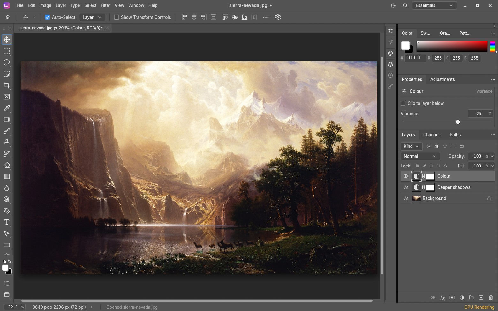
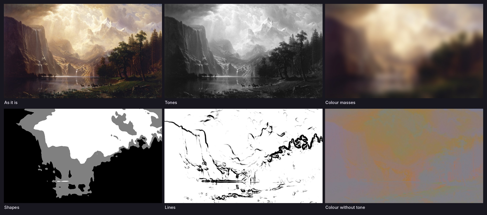

<p align="center">
  
</p>

<h1 align="center">MagicPic</h1>

<p align="center">
  Trình chỉnh ảnh nhiều lớp, viết bằng Rust, để bạn <em>và</em> một AI agent<br>
  cùng nhìn ảnh, chỉnh, nhìn lại rồi xuất.
</p>

<p align="center"><a href="README.md">English</a></p>

<p align="center">
  
</p>

> **Trạng thái: alpha sớm.** MagicPic là một bản fork của
> [PhotoCraft](https://github.com/storytold/photocraft) do nhóm ArtCraft làm. Hiện mới được
> build và kiểm thử từ mã nguồn trên Linux; chưa chạy trên Windows hay macOS, chưa có bộ cài
> hay bản phát hành. Xem [Đã kiểm chứng gì](#đã-kiểm-chứng-gì).

## MagicPic là gì

- **Một trình chỉnh ảnh thật.** Layer, nhóm, mask, lớp điều chỉnh, smart object với smart
  filter, chữ, hình vector, cọ vẽ, bộ lọc, vùng chọn, lịch sử kèm snapshot. Tài liệu RGB,
  Grayscale, CMYK, Lab ở 8, 16 và 32 bit mỗi kênh, có quản lý màu ICC. Đọc/ghi PSD/PSB, TIFF
  nhiều lớp, PNG, JPEG, WebP, OpenEXR và nhiều định dạng khác; định dạng nhiều lớp riêng là
  `.pcraft`.
- **Mọi thao tác là một lệnh.** Mỗi mục menu, công cụ, hộp thoại đều chạy một trong hơn 1.000
  lệnh của cùng một sổ đăng ký. App, dòng lệnh và giao diện cho agent gọi chung các lệnh đó,
  nên việc gì bạn bấm được thì agent làm được.
- **Native.** egui trên wgpu, không webview, không JavaScript. Cùng mã Rust đó biên dịch được
  sang WebAssembly.

## MagicPic thêm gì

### Seeing: nhìn trước khi chỉnh

<p align="center">
  
</p>

Năm chế độ quan sát cho thấy từng thuộc tính thị giác của ảnh: **sắc độ**, **khối màu**,
**mảng hình** trên khoảng trống, **đường nét**, và **màu không sắc độ**. Chế độ quan sát chỉ
để nhìn: không bao giờ ghi vào tài liệu nên không thể lọt vào ảnh xuất.

- **View › Seeing** mở một chế độ quan sát thành bản "study" riêng cạnh ảnh của bạn.
- **Khung ngẫu nhiên** chọn chỗ để nhìn theo một seed chứ không theo thói quen; cùng seed thì
  tìm lại được đúng khung đó.
- **Biến thể** thử một ý tưởng trên bản sao: thừa/thiếu sáng, rung máy, mất nét, khung hình
  khác. Ảnh gốc không bị đụng tới. Mỗi biến thể lưu **recipe**; chạy lại recipe ra đúng từng
  điểm ảnh.
- Không có gì chấm điểm ảnh hay chọn hộ bạn. Bạn có thể ghi lại phản ứng của chính mình vào
  từng biến thể.

### Một trình chỉnh ảnh mà agent dùng an toàn

`magicpic-cli mcp` là một server [MCP](https://modelcontextprotocol.io). Nối Claude hoặc
Codex vào rồi nói điều bạn muốn bằng lời thường.

- Agent **nhìn** được tài liệu: cả ảnh, một vùng ở kích thước thật, hoặc bất kỳ chế độ quan
  sát nào.
- Nó chỉnh bằng chính lệnh của trình chỉnh ảnh, ưu tiên lớp điều chỉnh, mask và smart filter
  để kết quả vẫn chỉnh tiếp được.
- **Được cả hoặc không gì cả:** một loạt thao tác hoặc áp dụng trọn vẹn, hoặc để mọi tài liệu
  nguyên như cũ.
- **Không ghi đè việc bạn làm:** thao tác có thể gắn với đúng tài liệu và đúng trạng thái mà
  agent vừa xem. Nếu bạn đã sửa tay trong lúc đó, thao tác của agent bị từ chối.
- **Chế độ bridge** sửa chính tài liệu đang mở trong app: bạn thấy ngay và chen vào được.
- Chỉ đọc và ghi trong thư mục bạn cấp; chỉ báo "đã lưu" sau khi tìm thấy file trên đĩa.

Cài về máy và nối với Claude hoặc Codex (kèm một đoạn lời nhắn để agent tự cài):
[`docs/vi/cai-dat-va-ket-noi.md`](docs/vi/cai-dat-va-ket-noi.md). Cấu hình cho Claude Code,
Claude Desktop và Codex, cùng các câu lệnh mẫu:
[`docs/vi/art-of-seeing-va-mcp.md`](docs/vi/art-of-seeing-va-mcp.md).

## Bắt đầu

### Nhờ agent cài

Trên máy mới, dán đoạn này vào Claude Code hoặc Codex. Agent sẽ cài thứ còn thiếu (có hỏi bạn
trước), build MagicPic, mở app và tự nối nó vào chính agent. Về sau, dán lại đúng đoạn này là
cập nhật.

```text
Cài và mở MagicPic trên máy này, rồi nối nó với chính bạn qua MCP để tôi chỉnh ảnh bằng cách
nói chuyện với bạn.

Mã nguồn: https://github.com/vansyson1308/vansysoneditphoto
Làm đúng theo hướng dẫn dành cho agent:
https://raw.githubusercontent.com/vansyson1308/vansysoneditphoto/main/docs/agent-setup.md
Nếu không đọc được trang đó, hãy chạy `git clone --depth 1` với mã nguồn ở trên rồi đọc
docs/agent-setup.md trong bản clone.

Hỏi tôi trước khi cài phần mềm hệ thống hoặc dùng quyền quản trị. Chỉ cấp quyền cho một thư mục
ảnh. Không in token ra màn hình. Nói với tôi bằng tiếng Việt. Cuối cùng báo lại những gì đã làm
và câu tôi cần nói sau khi khởi động lại bạn.
```

Giải thích và cách cài bằng tay: [`docs/vi/cai-dat-va-ket-noi.md`](docs/vi/cai-dat-va-ket-noi.md).

### Tự cài

Cần Rust (stable); trên Linux cần thêm các gói phát triển nêu trong
[`docs/development.md`](docs/development.md#prerequisites).

```sh
git clone https://github.com/vansyson1308/vansysoneditphoto magicpic
cd magicpic
cargo run --release -p magicpic -- anh.jpg         # app desktop
cargo install --path apps/magicpic-cli --locked    # dòng lệnh và server MCP
```

## Đã kiểm chứng gì

Đã kiểm trên Linux (x86-64, dựng hình phần mềm), từ mã nguồn:

- Các bộ test của engine, dòng lệnh, MCP và giao diện.
- Một lượt chạy đầu-cuối qua server MCP: nhập ảnh, chỉnh tone, xem trước, xuất và mở lại file
  xuất; chỉnh cục bộ qua mask; biến thể với recipe chạy lại; undo/redo; lưu và mở lại project;
  batch lỗi, file hỏng, ghi không có quyền.
- Chế độ bridge với app desktop đang chạy.
- Một phiên chỉnh ảnh thật với Claude Code, cả headless lẫn bridge.

Chưa kiểm chứng:

- **Windows và macOS.** Mã đa nền tảng và có sẵn script đóng gói thừa hưởng từ bản gốc trong
  `packaging/`, nhưng MagicPic chưa được build, chạy hay đóng gói ở đó.
- **Bộ cài, ký số và tự cập nhật.** Chưa có bản phát hành MagicPic. Script đóng gói và
  workflow CI là thừa hưởng, còn giả định hạ tầng của dự án gốc; cần rà riêng trước lần phát
  hành đầu.
- **Phiên Codex và Claude Desktop.** Server theo chuẩn MCP và Codex nhận cấu hình, nhưng chưa
  chạy trọn một phiên với hai client này.
- **Bản dịch giao diện.** Giao diện là tiếng Anh trừ khi build kèm bộ dịch của dự án gốc
  (`CRAFT_I18N_DIR`, xem [`docs/localization.md`](docs/localization.md)); khi đó bản build tự
  thay tên sản phẩm thành MagicPic trong bộ dịch. Những câu do MagicPic thêm (như menu Seeing)
  vẫn là tiếng Anh ở mọi ngôn ngữ.

## MagicPic từ đâu ra

MagicPic là phiên bản đã sửa đổi của [PhotoCraft](https://github.com/storytold/photocraft),
Copyright (c) 2026 ArtCraft Team and the PhotoCraft contributors, dùng theo giấy phép MIT và
Apache-2.0. Lõi chỉnh ảnh, phần PSD, bộ dựng hình và giao diện là công sức của họ; MagicPic
đổi tên sản phẩm và thêm các công cụ Seeing cùng các tính năng an toàn cho agent nêu trên.
MagicPic không do nhóm ArtCraft làm, tài trợ hay bảo chứng, và không dùng tên hay logo
ArtCraft.

Hai giấy phép này **bắt buộc giữ** dòng bản quyền gốc và ghi rõ đây là bản đã sửa đổi, nên
phần ghi nhận nguồn gốc này (cùng `LICENSE-MIT`, `NOTICE`) không thể gỡ. Các liên kết tới
issue và pull request của `storytold/photocraft` trong tài liệu và mã nguồn được giữ có chủ
đích: đó là lịch sử của mã này. MagicPic đánh số phiên bản nối tiếp PhotoCraft, nên phiên bản
dưới 0.23 trong tài liệu hay chú thích là bản phát hành của PhotoCraft. MagicPic vẫn mở được
những gì PhotoCraft đã lưu: project `.pcraft`, droplet và sidecar Camera Raw.

Những người đã viết ra mã này được ghi công trong app ở
**Help › About MagicPic › Contributors**.

## Giấy phép

Tùy bạn chọn [Apache License 2.0](LICENSE-APACHE) hoặc [MIT](LICENSE-MIT). Thành phần của bên
thứ ba giữ giấy phép riêng: xem [`NOTICE`](NOTICE) và [`ATTRIBUTION.md`](ATTRIBUTION.md).
